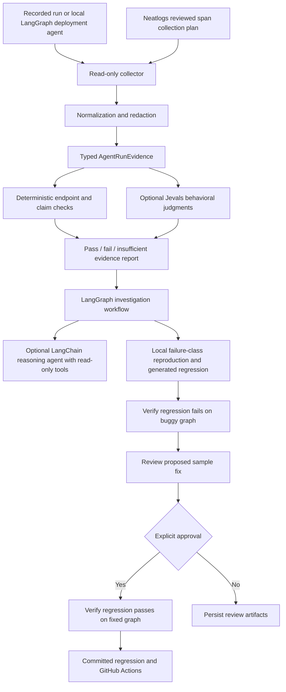

# MVP architecture

## Responsibilities

- `evidence.py`: typed normalized evidence, provenance, schema validation.
- `neatlogs.py`: GET-only payload client, reviewed extraction plan, independent
  host-allowed HTTP probe, bounded retries, response-size limits, no redirects.
- `redaction.py`: sensitive fields, common credential/PII patterns, URL credentials
  and configured environment secrets. Applies before persistence and model use.
- `evaluation.py`: endpoint status/content checks, explicit incompleteness,
  freshness relative to the final claim, conservative success-claim phrases,
  optional Jevals `Grounded`, `UsedToolResult`, and custom `SuccessSupported`.
- `investigator.py`: LangGraph evidence analysis, optional LangChain reasoning
  agent, trusted regression generation, pre-fix failure, review, post-fix pass.
- `sample_agent.py`: LangChain deployment/health tools and LangGraph sample agent;
  the buggy graph skips verification, the fixed graph gates success on health.
- `regression.py`: safe test template populated with observations/criteria,
  temporary subprocess reproduction, captured assertion output, proposed diff.
- `reporting.py`: redacted JSON artifacts and escaped standalone HTML report.
- `cli.py`: explicit integration/model/approval flags. Default is local only.

## Integrity boundaries and limitations

External state is separate from the agent's own statements. Transport failure,
stale observations, missing bodies, unsupported claims, and relevant truncated
payloads stay insufficient evidence. Jevals failures raise suspicion and need
corroboration; mock backends only validate integration plumbing.

The optional model has two read-only, evidence-scoped LangChain tools. Neither
can read arbitrary files, perform deployments, select shell commands, or modify
code. A bounded recursion limit prevents an unbounded model/tool loop. Model
citations are checked against the evidence IDs. Its reasoning is a hypothesis.

Regression source comes from a trusted template, with recorded data encoded as
JSON inside a Python string literal. No trace instruction becomes executable
code. Sample workers have temporary working directories, stripped secret-related
environment variables, timeouts, and loopback endpoints. This is process and
filesystem isolation for trusted demo code, not an OS security sandbox for
untrusted production code. Use E2B/containers before extending reproduction to
arbitrary agent applications.

Fix approval applies only to running the fixed local sample. The product does
not edit, merge, or deploy production source. CI changes and permanent regression
artifacts are reviewable repository files. GitHub Actions will run when the
project is placed in a GitHub repository; no hosted CI run is claimed here.

Heuristic redaction is not universal PII detection. Review sensitive real-data
plans and payloads before enabling third-party evaluation. Full system prompts
are not requested by the example plan or sent by the model adapters.

The manual selected-payload adapter uses explicit span IDs, field paths, and
original timestamps from a reviewed plan. The per-request monitor adds Public
API cursor discovery and the documented read-only MCP full-context tool. It
evaluates finalized requests, preserves hierarchy, and reports incomplete
coverage. See [monitor guide](neatlogs-monitor.md). Public API span-list/export
schemas remain unverified; the implementation does not guess them. Recorded
response bundles are synthetic contract examples.
